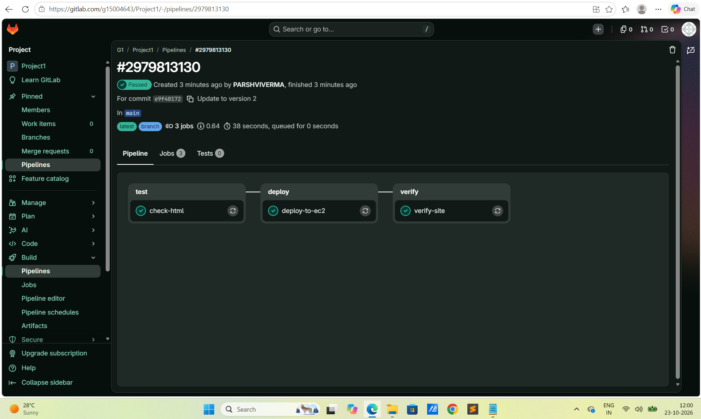
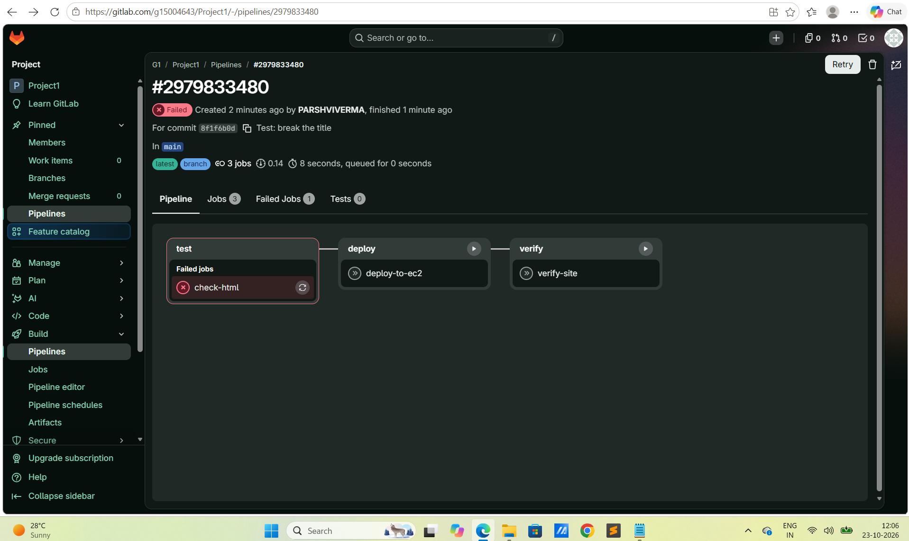
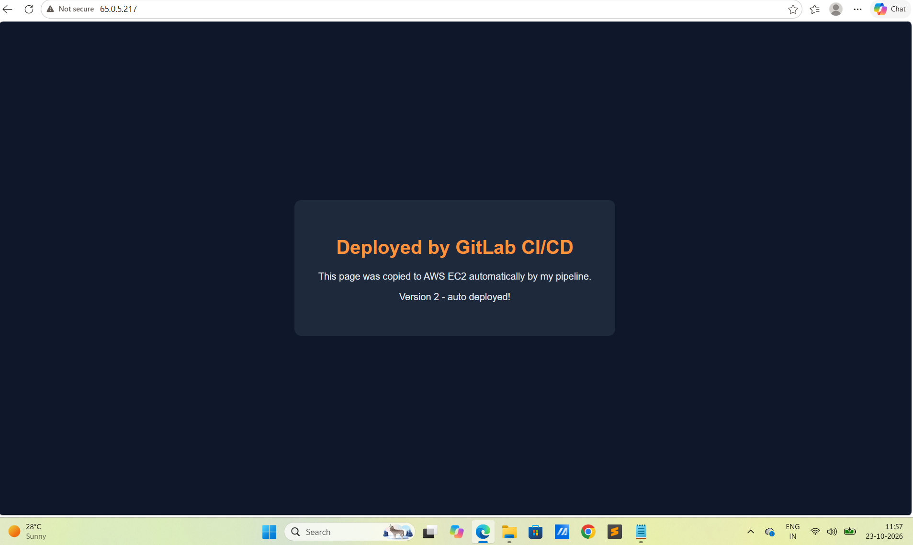

# GitLab CI/CD → AWS EC2 Auto-Deploy

A GitLab CI/CD pipeline that **tests a static website and automatically deploys it to an AWS EC2 server** (Ubuntu + nginx) over SSH, then **verifies the site is live** with a post-deployment health check.

Every commit to `main` goes through three stages automatically: **test → deploy → verify**. If the test fails, the deployment is skipped and the live site stays safe.

> The pipeline ran on **GitLab.com** (shared runners). This GitHub repository is a portfolio copy of the code and results. The AWS server was terminated after the project to avoid ongoing costs.

---

## Architecture


---

## Tech stack

| Area | Tools |
| --- | --- |
| CI/CD | GitLab CI/CD, GitLab shared runners |
| Cloud | AWS EC2 (t3.micro, Ubuntu 24.04 LTS, Mumbai region) |
| Web server | nginx |
| Deployment | SSH, scp |
| Containers | Alpine Linux Docker images (for pipeline jobs) |
| Testing | Shell checks (`test`, `grep`), `curl` health check |
| Website | HTML, CSS |

---

## Pipeline stages

| Stage | Job | What it does |
| --- | --- | --- |
| **test** | `check-html` | Confirms `public/index.html` exists, is a real HTML document, and has a `<title>` |
| **deploy** | `deploy-to-ec2` | Connects to EC2 over SSH, clears the web root, and copies the site with `scp` |
| **verify** | `verify-site` | Downloads the live page with `curl` and confirms the correct page is being served |

Deploy and verify run **only on the `main` branch**, and only when the server variables are configured.

---

## Project structure

```
.
├── .gitlab-ci.yml          # The CI/CD pipeline (3 stages)
├── public/
│   └── index.html          # The website that gets deployed
├── screenshots/            # Proof of the working pipeline and live site
└── README.md
```

---

## How it works

### 1. AWS EC2 setup
- Launched a **t3.micro** Ubuntu 24.04 instance in **ap-south-1 (Mumbai)**
- Security group: **SSH (22)** for the pipeline, **HTTP (80)** for visitors
- Installed and enabled nginx:
  ```bash
  sudo apt update
  sudo apt install -y nginx
  sudo systemctl enable --now nginx
  sudo chown -R ubuntu:ubuntu /var/www/html
  ```

### 2. GitLab CI/CD variables (secrets)
Stored in **Settings → CI/CD → Variables**, never in the code:

| Variable | Type | Purpose |
| --- | --- | --- |
| `EC2_HOST` | Variable (protected) | Public IP of the EC2 server |
| `SSH_PRIVATE_KEY` | File (protected) | Private key used to SSH into the server |

### 3. Automatic deployment
Any commit to `main` triggers the pipeline. Changing one line of HTML (`Version 1` → `Version 2`) was tested, deployed and verified live in under a minute with no manual steps.

---

## Screenshots

### ✅ Successful pipeline: test → deploy → verify


### 🛡️ Safety net: failed test blocks deployment
A commit that removed the page `<title>` failed the `check-html` job, so deploy and verify never ran and the live site stayed unchanged.



### 🌐 Live site on AWS EC2 (auto-deployed Version 2)


---

## Problems I faced and how I fixed them

| Problem | Cause | Fix |
| --- | --- | --- |
| `check-html` failed: `test -f public/index.html` | File was created in a wrongly named folder (hidden space in `public `) | Recreated the file at the exact path and deleted the duplicate folder |
| `deploy-to-ec2` failed: `hostname contains invalid characters` | The `EC2_HOST` variable had a hidden space/newline after the IP | Retyped the IP by hand with no trailing characters |
| Site showed pipeline code instead of the web page | YAML was accidentally pasted into `index.html`; the checks still passed because the YAML contained the words they looked for | Restored the HTML and **strengthened both checks** to require `<!DOCTYPE html>` |

**Key lesson:** a pipeline only catches what its checks test for, so health checks should verify something unique to the correct output.

---

## Cost optimisation

- Single **t3.micro** instance, default 8 GB disk, **no Elastic IP**
- **AWS zero-spend budget** alert set up before launching anything
- Completed the project in one sitting and **terminated the instance** immediately after
- Verified cleanup: no leftover volumes, Elastic IPs, or running instances in any region
- Total AWS cost: **a few rupees**

---

## Possible improvements

- Use a domain name and HTTPS (Let's Encrypt)
- Restrict SSH access using a self-hosted runner with a fixed IP
- Deploy a React or Node.js application with a build stage and artifacts
- Use Infrastructure as Code (Terraform) to create and destroy the EC2 server

---

## Author

**Parshvi Verma**
- GitLab: [@PARSHVIVERMA](https://gitlab.com/PARSHVIVERMA)
- LinkedIn: https://www.linkedin.com/in/parshvi-verma-714642190/
